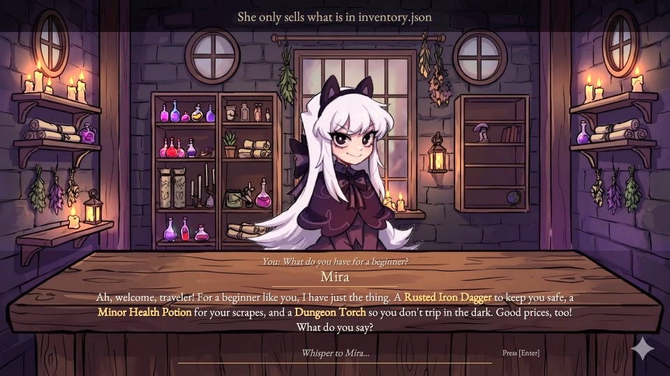

# Shopkeeper NPC

An NPC in Unity (C#) that talks to players in character, powered by an LLM. Mira only sells what is in her shop, stays in the fantasy world, and returns structured JSON that the game uses to highlight the items she mentions. Built as the AI project for the VNG AI Builder Residency application.

## Demo

[](docs/mira_demo.mp4)

**[▶ Watch the demo video (26 s)](docs/mira_demo.mp4)**

The questions in the video are typed by a script. Every reply is a live LLM response.

## How it works

```
Player question
      │
      ▼
PromptBuilder ── persona.json + inventory.json + last 6 turns
      │
      ▼
LLM call → JSON { reply, mentioned_items }
      │
      ▼
Safe parse ── success: show the reply and highlight the items
          └── failure: show the fallback line
```

The API is stateless, so the last 6 turns are re-sent with every request. The inventory goes into the system prompt so the model has real items and prices to draw on (grounding).

Not built yet: the code check for items and prices, the judge call with retry, the trace log and the eval. See the milestones in [PROJECT.md](PROJECT.md).

## Run it

1. Set the environment variable `LLM_API_KEY` to a Gemini API key, then restart Unity Hub so Unity can see it.
2. Open the project in Unity 6000.3.15f1.
3. Open `Assets/Scenes/SampleScene.unity` and press Play.

The key is only read from the environment. In a real game, the client would call a backend, and only the backend would hold the key.
